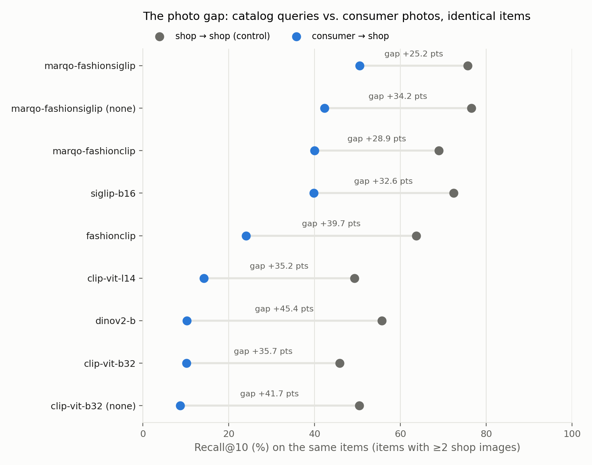

# resale-retrieval-bench

How much accuracy do off-the-shelf vision-language embeddings lose when the query is a phone photo of a garment instead of a catalog image, and does fashion-specific training close the gap?

This repository benchmarks **zero-shot** image embeddings (no fine-tuning) on the DeepFashion **Consumer-to-Shop Clothes Retrieval** benchmark and measures the *photo gap*: retrieval accuracy for consumer photos versus catalog photos of the **same items**.

Code for the paper *The Photo Gap: How Much Retrieval Accuracy Consumer Photos Cost Zero-Shot Fashion Encoders* (R. Mohanty, 2026; preprint forthcoming).

## Results (Nov 2026 run, one T4)

Consumer → shop, 47,434 test queries against a 22,669-image gallery, garment-box crop. Full tables in [`results/summary.csv`](results/summary.csv), figures in [`results/report/`](results/report/).

| Model | R@1 | R@10 | R@20 | Shop→shop R@10 (same items) | Consumer→shop R@10 (same items) | Photo gap |
|---|---|---|---|---|---|---|
| CLIP ViT-B/32 | 3.7 | 7.9 | 9.8 | 45.8 | 10.2 | 35.7 |
| CLIP ViT-L/14 | 5.4 | 10.9 | 13.1 | 49.3 | 14.1 | 35.2 |
| SigLIP ViT-B/16 | 15.6 | 35.7 | 42.2 | 72.4 | 39.8 | 32.6 |
| FashionCLIP | 8.7 | 20.6 | 25.2 | 63.7 | 24.0 | 39.7 |
| Marqo-FashionCLIP | 15.5 | 35.7 | 42.6 | 68.9 | 40.0 | 28.9 |
| **Marqo-FashionSigLIP** | **22.2** | **46.6** | **53.4** | 75.7 | 50.5 | **25.2** |
| DINOv2 ViT-B/14 | 4.0 | 8.3 | 10.2 | 55.7 | 10.2 | 45.4 |



Three findings beyond the ranking: the base model's pretraining matters as much as fashion fine-tuning (general SigLIP-B/16 ties fashion-tuned Marqo-FashionCLIP); scale barely matters (CLIP L/14 gains 1.7 R@1 over B/32); cropping to the garment box recovers about a quarter of the gap; lower-body garments retrieve at half the rate of tops and dresses for every model.

## Models

| Name | Family | Source |
|---|---|---|
| `clip-vit-b32`, `clip-vit-l14` | general VLM | OpenAI CLIP via open_clip |
| `siglip-b16` | general VLM | Google SigLIP (WebLI) via open_clip |
| `siglip2-b16` (optional) | general VLM | Google SigLIP 2 via transformers |
| `fashionclip` | fashion VLM | patrickjohncyh/fashion-clip |
| `marqo-fashionclip`, `marqo-fashionsiglip` | fashion VLM | Marqo, via open_clip hf-hub |
| `dinov2-b` | vision-only | facebook/dinov2-base (CLS token) |

## Protocol

- **Queries:** consumer images in the `test` partition. **Gallery:** shop images in `val` + `test` (the benchmark's own definition). A query is a hit at *K* if any top-*K* gallery image shares its item id.
- **Control:** shop → shop retrieval on items with ≥ 2 shop images, excluding the query image. **Paired gap** = control − consumer-to-shop, computed on the same items.
- **Breakdowns:** clothes type (upper / lower / full-body), category folder.
- **Ablation:** bounding-box crop (default, 10 % padding) vs. full image.
- Cosine similarity on L2-normalised embeddings; Recall@{1,5,10,20,50} and MRR.

## Run

```bash
pip install -r requirements.txt
bash scripts/download_deepfashion.sh /data            # or see RUN_GUIDE.md
bash scripts/run_all.sh /data/Consumer_to_shop out    # ~2–4 h on a T4; hours longer on CPU
cat out/report/results.md
```

Colab: open `run_colab.ipynb` (GPU runtime). Outputs persist to Google Drive.

Single steps:

```bash
python -m rrb.embed    --root DATA --out out --model clip-vit-b32 --crop bbox
python -m rrb.evaluate --out out
python -m rrb.report   --out out
```

## Test (no dataset or downloads needed)

```bash
bash tests/test_pipeline.sh
```

Builds a synthetic dataset in the DeepFashion layout, checks that identical consumer/shop images give Recall@1 = 1.0, and runs every backend with tiny random weights to exercise the code paths.

## Layout

```
rrb/data.py      parse annotations, build query/gallery sets
rrb/models.py    model registry (open_clip, transformers, random)
rrb/embed.py     embedding extraction  -> out/emb/<model>__<crop>/
rrb/evaluate.py  recall@K, MRR, control, gap, breakdowns -> out/results/
rrb/report.py    figures + results.md  -> out/report/
paper/outline.md paper skeleton
```

## Dataset and citation

DeepFashion is released for non-commercial research use. Cite:

> Z. Liu, P. Luo, S. Qiu, X. Wang, X. Tang. *DeepFashion: Powering Robust Clothes Recognition and Retrieval with Rich Annotations.* CVPR 2016.

Model citations: Radford et al. 2021 (CLIP); Zhai et al. 2023 (SigLIP); Chia et al. 2022 (FashionCLIP); Marqo 2024 (Marqo-FashionCLIP/SigLIP); Oquab et al. 2023 (DINOv2).
